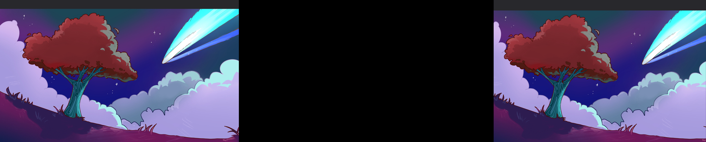
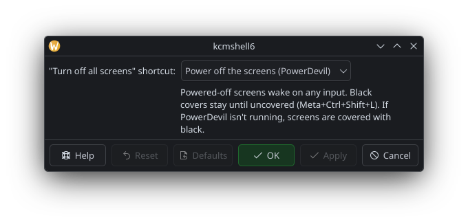

# Lights Out

"Turn off" specific screens in KDE Plasma 6 (Wayland) without disconnecting
them, by covering them with black. Useful on OLED and local-dimming panels,
where black pixels or zones are off. `kscreen-doctor --dpms off` can only blank
every screen at once.

It's a KWin script: KWin itself draws a black window over each covered output,
above panels and fullscreen windows. Outputs stay enabled and in the layout,
so windows and the desktop don't get rearranged.



## Install

### KDE Store (recommended)

Lights Out is on the KDE Store:
[store.kde.org/p/2381133](https://store.kde.org/p/2381133/).

1. Open System Settings > Window Management > KWin Scripts.
2. Click **Get New...**, search for "Lights Out" and install it.
3. Tick **Lights Out** and click **Apply**.

Updates arrive through the same dialog. This gives you the shortcuts and
settings; for the `lights-out` command-line tool, install from source.

### From source

```bash
git clone https://github.com/Brunight/lights-out.git
cd lights-out
./install.sh
```

This installs the script with `kpackagetool6`, enables it, and links the
`lights-out` CLI into `~/.local/bin`.

KWin caches QML files until it restarts, so after upgrading a running script,
log out and back in.

## Use

Global shortcuts (change them in System Settings > Keyboard > Shortcuts > KWin):

| Shortcut            | Action                             |
| ------------------- | ---------------------------------- |
| `Meta+Ctrl+L`       | toggle the screen under the cursor |
| `Meta+Ctrl+Shift+L` | uncover all screens                |
| `Meta+Ctrl+Alt+L`   | turn off all screens (see Settings) |
| (unbound)           | "Lights Out: Toggle OUTPUT", one per output |

## Settings

System Settings > Window Management > KWin Scripts > Lights Out > Configure:

- **"Turn off all screens" shortcut** (`Meta+Ctrl+Alt+L`):
  - *Power off the screens (PowerDevil)*, the default: powers them off
    (DPMS) through PowerDevil's "Turn Off Screen" action, like
    `kscreen-doctor --dpms off`. Any input wakes them. If PowerDevil isn't
    running, the screens get covered with black instead.
  - *Cover every screen with black*: covers stay until you uncover them.

Or from a terminal: `kwriteconfig6 --file kwinrc --group Script-lightsout
--key TurnOffMode Black` (or `PowerDevil`). Changes apply the next time you
press the shortcut.



## Command line

```bash
lights-out on HDMI-A-1 DP-3   # cover outputs (names from `lights-out list`)
lights-out off [OUTPUT...]    # uncover (no args = all)
lights-out toggle [OUTPUT...] # no args = the screen under the cursor
lights-out status
lights-out list
```

The CLI needs `qdbus6`, `kscreen-doctor` and systemd's journal. It triggers the
script's shortcuts over D-Bus and reads the script's state back from the KWin
journal (`journalctl --user -u plasma-kwin_wayland`).

## Limitations

- Covers can't take keyboard focus (KWin never focuses its own windows), so
  there's no "press Esc to uncover". Use `Meta+Ctrl+Shift+L` instead. On the
  plus side, a cover never takes keystrokes away from your other screens.
- The mouse pointer stays visible over a covered screen: KWin doesn't apply
  cursor shapes to its own windows yet.
- Clicks and scrolling on a covered screen are swallowed. They don't reach
  the windows underneath.
- An unplugged or disabled output is uncovered. Restarting KWin uncovers
  everything.

## Releasing

1. Bump `Version` in `package/metadata.json` and commit.
2. Tag and push: `git tag -a v1.1 -m "Lights Out 1.1" && git push origin v1.1`.
3. The [Release workflow](.github/workflows/release.yml) builds
   `lights-out-1.1.kwinscript` and publishes a GitHub release with it. It
   fails if the tag doesn't match the version in `metadata.json`.
4. On the KDE Store page, add the new release file's URL and set the version.

To build the archive locally, run `./package.sh` (writes
`dist/lights-out-VERSION.kwinscript`).

## License

GPL-3.0-or-later. See [LICENSE](LICENSE).
